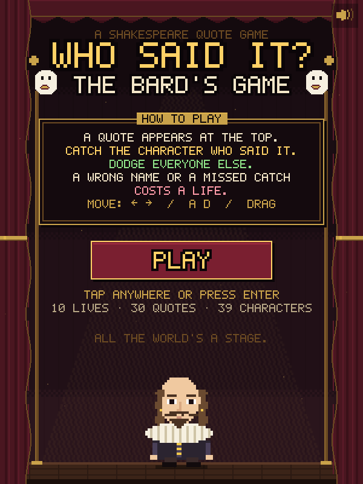
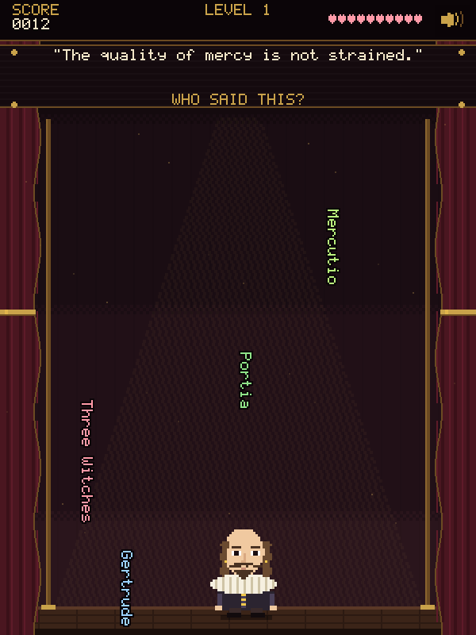
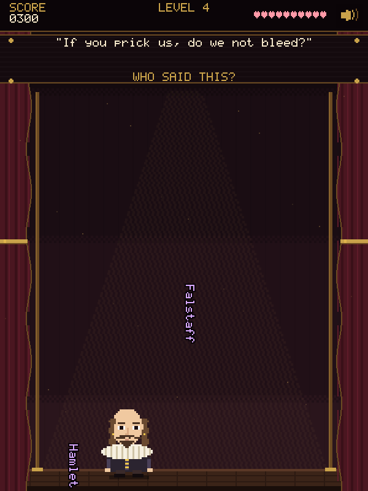

# 🎭 Who Said It? — The Bard’s Game

A fast-paced **pixel-art** browser game about Shakespeare. A famous quote appears at the top of the screen while the names of Shakespearean characters rain down from above. Steer a tiny pixel Shakespeare left and right, **catch the character who said the line**, and **dodge everyone else**.

**▶ Play it now: [bardsgame.pages.dev](https://bardsgame.pages.dev)**

**🎮 Also on itch.io: [andguerreiro.itch.io/bardsgame](https://andguerreiro.itch.io/bardsgame)**

<p align="center">
  
</p>

---

## Screenshots

<table>
  <tr>
    <td align="center"><br><sub>Title screen</sub></td>
    <td align="center"><br><sub>Gameplay</sub></td>
    <td align="center"><br><sub>A correct catch</sub></td>
  </tr>
  <tr>
    <td align="center"><br><sub>Faster names</sub></td>
    <td align="center"><br><sub>Game over and share</sub></td>
    <td></td>
  </tr>
</table>

## How to play

1. Tap **Play** (or press `Enter`). You start with **10 lives**.
2. Read the quote at the top of the screen.
3. Catch the name of the character who said it before it hits the floor.
4. Avoid all the other names. They fall vertically, at different speeds.

You lose a life when you:

- catch the **wrong** character, or
- let the **right** character fall to the floor.

When your lives run out, the curtain falls. Your best score is saved in your browser. On the game-over screen you can tap **Play Again**, or tap **Share Score** (or press `S`) to send your score and the game link to friends. On phones this opens the share sheet; on desktop it copies the message to your clipboard.

### Automatic difficulty

There is no difficulty menu. The game starts gentle and speeds up on its own as you catch the right characters:

| Stage  | Reached after        | Fall speed |
| ------ | -------------------- | ---------- |
| Easy   | start                | Slower     |
| Normal | 5 correct catches    | Standard   |
| Hard   | 12 correct catches   | Faster     |

Your lives are not reset when the stage changes.

### Scoring

- Each correct catch earns **10 points**, plus **2 bonus points per catch in your current streak** (the bonus caps at +20).
- Wrong catches and misses reset your streak.
- Every **4 correct catches** you level up, and the names fall faster.

## Controls

| Action                       | Keyboard                    | Mouse / Touch           |
| ---------------------------- | --------------------------- | ----------------------- |
| Move                         | `←` `→` or `A` `D`          | Click/tap and drag      |
| Mute / unmute sound          | `M`                         | Tap the speaker icon    |
| Share score (game over)      | `S`                         | Tap **Share Score**     |
| Start / replay               | `Enter` or `Space`          | Tap anywhere on the title screen, or **Play Again** |

The game works on desktop and mobile browsers.

## Features

- **Complete pixel-art presentation**: a hand-built 5×7 bitmap font, a chunky Shakespeare sprite, theater curtains, a dithered spotlight, pixel UI panels, hearts, masks and particles
- 60 of Shakespeare’s most famous quotes, from *Hamlet*, *Macbeth*, *Romeo and Juliet*, *Julius Caesar*, *King Lear*, *Othello*, *The Tempest*, *Twelfth Night*, *A Midsummer Night’s Dream*, *The Merchant of Venice*, *As You Like It*, *Richard III*, *Henry IV*, *Henry V*, *Antony and Cleopatra* and more
- 45 characters to catch (or avoid)
- Automatic difficulty ramp: Easy → Normal → Hard
- Names that fall vertically at random speeds, with a walking bob for the Bard
- Streak bonuses and a level system
- Sound effects for catches, mistakes, level-ups and game over, with a mute button (your choice is remembered)
- Local best score (stored with `localStorage`)
- Installable as an app on phones and desktops, with offline play
- A **Share Score** button on the game-over screen (share sheet on phones, clipboard on desktop)
- Pixel-art favicon, cover art, social preview image, animated GIF and screenshots
- No dependencies, no build step: a single HTML file with plain JavaScript and the Canvas API

## Install it on your phone

The game is a Progressive Web App (PWA), so you can add it to your home screen and play it like an app, even offline.

- **Android (Chrome):** open [bardsgame.pages.dev](https://bardsgame.pages.dev), tap the **⋮** menu, then **Install app** (or **Add to Home screen**).
- **iPhone and iPad (Safari):** open the page, tap the **Share** button, then **Add to Home Screen**.
- **Desktop (Chrome or Edge):** click the install icon at the right end of the address bar.

After the first visit the game works without a connection. When you publish a new version, change the `CACHE` name at the top of `sw.js` (for example to `bardsgame-v2.1`) so players receive the update.

The installable version only works from the Cloudflare page. On itch.io the game runs inside the itch.io page, so the install option isn't available there.

## Run it locally

Clone the repository and open the page in a browser:

```bash
git clone https://github.com/andguerreiro/bardsgame.git
cd bardsgame
open index.html   # macOS; on Linux use xdg-open, on Windows just double-click the file
```

Or serve it with any static server:

```bash
python3 -m http.server 8000
# then visit http://localhost:8000
```

## Deploy with Cloudflare Pages

The game is hosted on [Cloudflare Pages](https://pages.cloudflare.com/) at **https://bardsgame.pages.dev**. It is a static site, so there is nothing to build.

**Option A: connect the GitHub repository (recommended)**

1. In the Cloudflare dashboard, go to **Workers & Pages → Create → Pages → Connect to Git**.
2. Select the `andguerreiro/bardsgame` repository.
3. Use these settings:
   - **Project name:** `bardsgame` (this gives you the `bardsgame.pages.dev` address)
   - **Production branch:** `main`
   - **Framework preset:** None
   - **Build command:** leave empty
   - **Build output directory:** `/` (the repository root)
4. Click **Save and Deploy**. Every push to `main` is deployed automatically.

**Option B: direct upload**

1. Go to **Workers & Pages → Create → Pages → Upload assets**.
2. Name the project `bardsgame` and upload the project folder (it needs `index.html`, `manifest.json`, `sw.js`, `favicon.ico` and the `icons/` folder; keep the `images/` folder too for the README pictures and the social preview image).
3. Click **Deploy site**.

## Project structure

```
bardsgame/
├── index.html        # the whole game: markup, styles, bitmap font and pixel art
├── manifest.json     # app manifest, so the game can be installed on a phone
├── sw.js             # service worker that caches the game for offline play
├── favicon.ico       # browser tab icon (kept at the root, where browsers look for it)
├── icons/            # favicon PNGs (16, 32, 48, 180 px) and the app icons
├── images/           # cover art, social preview, animated GIF and screenshots
│   └── sprite/       # the Shakespeare sprite, for reference
├── docs/
│   └── ITCH_PAGE.md  # the text of the itch.io game page
├── LICENSE           # MIT License
└── README.md
```

## Customizing the game

Everything lives in `index.html`. Look for these pieces near the top of the script:

- **`Q`**: the list of quotes. Each entry has the format `[quote, act, character, play]`. The act is shown at the bottom right of the quote panel. Example:

  ```js
  ["Brevity is the soul of wit.", "Act 2, Scene 2", "Polonius", "Hamlet"]
  ```

- **`POOL`**: every character name that can fall. The `character` of each quote must also appear here, spelled exactly the same way.
- **`DIFF`** and **`stage()`**: the speed multiplier of each stage and the number of correct catches that trigger Normal (5) and Hard (12). Tweak these to rebalance the game.
- **`PLAYS`**: maps stored play names to the display names shown after a correct catch. Play names that are not in this map are shown as written.
- **`SHARE_URL`** and **`shareScore()`**: the link and message used by the share button on the game-over screen.
- **`FS`**, **`FONT`** and **`textImage()`**: the 5×7 bitmap font. Add a glyph to `FS` (seven rows of five `0`/`1` bits) if you add text with a new symbol.
- **`BARD`** and **`BP`**: the Shakespeare sprite, drawn as a character map plus a palette. **`C`** is the full pixel-art palette.

## Tech

- HTML5 Canvas at a fixed 600×800 internal resolution, scaled up with nearest-neighbour pixels
- A hand-built 5×7 bitmap font rendered from `fillRect` glyphs, so there are no font files or external requests
- Service worker and web app manifest for installation and offline play
- Web Audio API (all sounds are generated in the browser, so there are no audio files)
- Vanilla JavaScript (no frameworks, no libraries)

## Credits and license

Created by [andguerreiro](https://github.com/andguerreiro).

AI tools were used throughout this project. Several AI assistants (large language models from different providers) helped with the game design, code, pixel artwork, visual refresh (Shakespeare sprite, favicon, screenshots, promotional artwork and animated preview) and page text.

The quotes are from the works of William Shakespeare, which are in the public domain. The game code is released under the [MIT License](LICENSE).

Made with a quill, a ruff collar, a 5×7 bitmap font and a lot of ado. *All the world’s a stage.*
