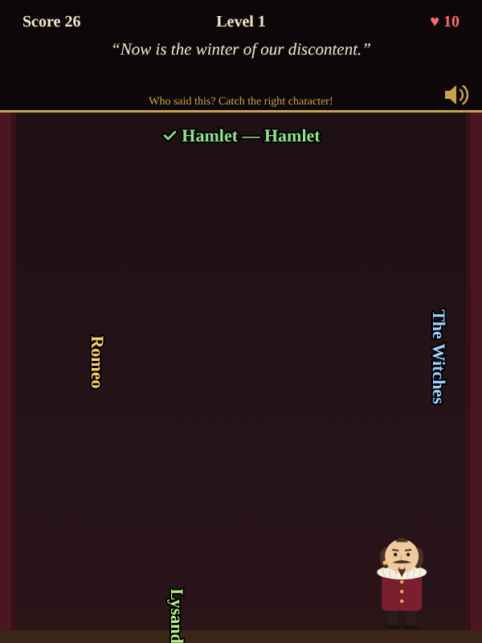
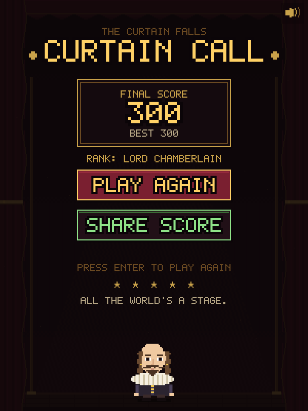

# 🎭 Who Said It? — The Bard’s Game

A fast-paced browser game about Shakespeare. A famous quote appears at the top of the screen while the names of Shakespearean characters rain down from above. Steer a tiny Shakespeare left and right, **catch the character who said the line**, and **dodge everyone else**.

**▶ Play it now: [bardsgame.pages.dev](https://bardsgame.pages.dev)**

**🎮 Also on itch.io: [andguerreiro.itch.io/bardsgame](https://andguerreiro.itch.io/bardsgame)**

<p align="center">
  
</p>

---

## Screenshots

<table>
  <tr>
    <td align="center"><br><sub>Title screen</sub></td>
    <td align="center"><br><sub>Gameplay</sub></td>
    <td align="center"><br><sub>A correct catch</sub></td>
  </tr>
  <tr>
    <td align="center"><br><sub>Faster names</sub></td>
    <td align="center"><br><sub>Game over and share</sub></td>
    <td></td>
  </tr>
</table>

## How to play

1. Tap **Play** (or press `Enter`). You start with **10 lives**.
2. Read the quote at the top of the screen.
3. Catch the name of the character who said it before it hits the floor.
4. Avoid all the other names. They fall vertically, at different speeds.

You lose a life when you:

- catch the **wrong** character, or
- let the **right** character fall to the floor.

When your lives run out, the curtain falls. Your best score is saved in your browser. On the game-over screen you can tap **Share your score** (or press `S`) to send your score and the game link to friends. On phones this opens the share sheet; on desktop it copies the message to your clipboard.

### Automatic difficulty

There is no difficulty menu. The game starts gentle and speeds up on its own as you catch the right characters:

| Stage  | Reached after        | Fall speed |
| ------ | -------------------- | ---------- |
| Easy   | start                | Slower     |
| Normal | 5 correct catches    | Standard   |
| Hard   | 12 correct catches   | Faster     |

Your lives are not reset when the stage changes.

### Scoring

- Each correct catch earns **10 points**, plus **2 bonus points per catch in your current streak** (the bonus caps at +20).
- Wrong catches and misses reset your streak.
- Every **4 correct catches** you level up, and the names fall faster.

## Controls

| Action                       | Keyboard                    | Mouse / Touch           |
| ---------------------------- | --------------------------- | ----------------------- |
| Move                         | `←` `→` or `A` `D`          | Click/tap and drag      |
| Share score (game over)      | `S`                         | Tap the share button    |
| Start / replay               | `Enter` or `Space`          | Tap anywhere on the title screen |

The game works on desktop and mobile browsers.

## Features

- 30 of Shakespeare’s most famous quotes, from *Hamlet*, *Macbeth*, *Romeo and Juliet*, *Julius Caesar*, *Richard III*, *The Merchant of Venice*, *As You Like It*, *Twelfth Night*, *A Midsummer Night’s Dream*, *The Tempest*, *Othello* and *Henry V*
- 39 characters to catch (or avoid)
- Automatic difficulty ramp: Easy → Normal → Hard
- Names that fall vertically at random speeds
- Streak bonuses and a level system
- Local best score (stored with `localStorage`)
- A **Share your score** button on the game-over screen (share sheet on phones, clipboard on desktop)
- No dependencies, no build step: a single HTML file with plain JavaScript and the Canvas API

## Run it locally

Clone the repository and open the page in a browser:

```bash
git clone https://github.com/andguerreiro/bardsgame.git
cd bardsgame
open index.html   # macOS; on Linux use xdg-open, on Windows just double-click the file
```

Or serve it with any static server:

```bash
python3 -m http.server 8000
# then visit http://localhost:8000
```

## Deploy with Cloudflare Pages

The game is hosted on [Cloudflare Pages](https://pages.cloudflare.com/) at **https://bardsgame.pages.dev**. It is a static site, so there is nothing to build.

**Option A: connect the GitHub repository (recommended)**

1. In the Cloudflare dashboard, go to **Workers & Pages → Create → Pages → Connect to Git**.
2. Select the `andguerreiro/bardsgame` repository.
3. Use these settings:
   - **Project name:** `bardsgame` (this gives you the `bardsgame.pages.dev` address)
   - **Production branch:** `main`
   - **Framework preset:** None
   - **Build command:** leave empty
   - **Build output directory:** `/` (the repository root)
4. Click **Save and Deploy**. Every push to `main` is deployed automatically.

**Option B: direct upload**

1. Go to **Workers & Pages → Create → Pages → Upload assets**.
2. Name the project `bardsgame` and upload the project folder (it needs `index.html` and `favicon.png` in the root; keep the `images/` folder too if you want the README pictures).
3. Click **Deploy site**.

## Project structure

```
bardsgame/
├── index.html   # the whole game: markup, styles and code
├── favicon.png  # site icon (a tiny Shakespeare)
├── images/      # GIF and screenshots used in this README
└── README.md
```

## Customizing the game

Everything lives in `index.html`. Look for these pieces near the top of the script:

- **`Q`**: the list of quotes. Each entry has the format `[quote, unused, character, play]`. The second field is not displayed, so you can leave it as an empty string. Example:

  ```js
  ["Brevity is the soul of wit.", "", "Polonius", "Hamlet"]
  ```

- **`POOL`**: every character name that can fall. The `character` of each quote must also appear here, spelled exactly the same way.
- **`DIFF`** and **`stage()`**: the speed multiplier of each stage and the number of correct catches that trigger Normal (5) and Hard (12). Tweak these to rebalance the game.
- **`PLAYS`**: maps stored play names to the display names shown after a correct catch. Play names that are not in this map are shown as written.
- **`SHARE_URL`** and **`shareScore()`**: the link and message used by the share button on the game-over screen.

## Tech

- HTML5 Canvas
- Vanilla JavaScript (no frameworks, no libraries)
- Georgia/serif system fonts, so there are no external requests

## Credits and license

Created by [andguerreiro](https://github.com/andguerreiro), with the game design, code, artwork (including the Shakespeare favicon and screenshots) and page text written by **Claude Sonnet 5.5**, an AI model made by [Anthropic](https://www.anthropic.com).

The quotes are from the works of William Shakespeare, which are in the public domain. The game code is released under the [MIT License](LICENSE).

Made with a quill, a ruff collar and a lot of ado. *All the world’s a stage.*
