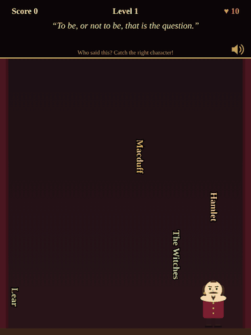

# 🎭 Who Said It? — The Bard’s Game

A fast-paced **pixel-art** browser game about Shakespeare. A famous quote appears at the top of the screen while the names of Shakespearean characters rain down from above. Steer a tiny pixel Shakespeare left and right, **catch the character who said the line**, and **dodge everyone else**.

**▶ Play it now: [bardsgame.pages.dev](https://bardsgame.pages.dev)**

**🎮 Also on itch.io: [andguerreiro.itch.io/bardsgame](https://andguerreiro.itch.io/bardsgame)**

<p align="center">
  
</p>

---

## Screenshots

<table>
  <tr>
    <td align="center"><br><sub>Title screen</sub></td>
    <td align="center"><br><sub>Gameplay</sub></td>
    <td align="center"><br><sub>A correct catch</sub></td>
  </tr>
  <tr>
    <td align="center"><br><sub>Faster names</sub></td>
    <td align="center"><br><sub>Game over and share</sub></td>
    <td></td>
  </tr>
</table>

## How to play

1. Tap **Play** (or press `Enter`). You start with **10 lives**.
2. Read the quote at the top of the screen.
3. Catch the name of the character who said it before it hits the floor.
4. Avoid all the other names. They fall vertically, at different speeds.

You lose a life when you:

- catch the **wrong** character, or
- let the **right** character fall to the floor.

When your lives run out, the curtain falls. Your best score is saved in your browser. On the game-over screen you can tap **Play Again**, or tap **Share Score** (or press `S`) to copy your score and the game link to the clipboard, ready to paste to friends anywhere.

### Fair play

The game is meant to be hard, not unfair:

- **Time to read.** The right name never drops in right after a new quote appears. It only shows up once you have had a moment to read (longer quotes give you more time), and it is sent your way after a few seconds at most.
- **Gaps to slip through.** Names that could reach Shakespeare at the same time are always spaced far enough apart to leave a gap you can fit through.
- **Honest hit zones.** The right name has a generous catch zone. A wrong name only costs you a life when it actually touches Shakespeare’s head, hair or robe, so a near miss is a miss.
- **No pause button.** The game never pauses. If you switch to another tab or app, the time you were away is replayed when you come back, with Shakespeare standing still, so leaving the game is no free pause (and no chance to look the answer up). Switching to another window while the tab stays visible doesn’t pause it either.

### Automatic difficulty

There is no difficulty menu. The game gets harder on its own, based on your total number of correct catches, in two ways:

- **Speed ramps up smoothly.** Every correct catch makes newly spawned names a little faster. Their speed is multiplied by ×0.65 at the start and rises in small steps to ×1.5 at 17 correct catches, with no sudden jumps. No name ever falls faster than a top speed of 440 game pixels per second.
- **Levels.** A new level arrives every 4 correct catches (level = 1 + total catches ÷ 4, rounded down). Each level raises the base speed of newly spawned names and gradually shortens the interval between spawns, down to a minimum base interval.

| Total correct catches | Level                          | Speed multiplier |
| --------------------- | ------------------------------ | ---------------- |
| 0–3                   | 1                              | ×0.65 to ×0.80   |
| 4–7                   | 2                              | ×0.85 to ×1.00   |
| 8–11                  | 3                              | ×1.05 to ×1.20   |
| 12–15                 | 4                              | ×1.25 to ×1.40   |
| 16–19                 | 5                              | ×1.45 to ×1.50   |
| 20 and up             | 6 and up (+1 every 4 catches)  | ×1.50 (maximum)  |

From 12 correct catches on, up to 5 names can be on screen at once (up to 4 before that).

These counts are cumulative, not a streak: mistakes do not reduce your level or speed. Your lives are not reset when the level changes. Names already falling keep their current speed.

### Scoring

- Each correct catch earns **10 points**, plus **2 bonus points per catch in your current streak** (the bonus caps at +20).
- Wrong catches and misses reset your streak.
- Level and difficulty progression use your total correct catches, separately from points and streak bonuses (see the table above).

### Ranks

When the game ends, you are given a rank based on your final score (not your level or total catches). It appears on the game-over screen:

| Final score | Rank             |
| ----------- | ---------------- |
| 0–119       | Groundling       |
| 120–249     | Player           |
| 250–399     | Lord Chamberlain |
| 400+        | The Bard Himself |

The names come from the Elizabethan theatre: a groundling was a spectator standing in the pit, a player was an actor, and the Lord Chamberlain was the patron of Shakespeare’s company.

## Controls

| Action                       | Keyboard                    | Mouse / Touch           |
| ---------------------------- | --------------------------- | ----------------------- |
| Move                         | `←` `→` or `A` `D`          | Tap or hold the left or right side of the screen |
| Mute / unmute sound          | `M`                         | Tap the speaker icon    |
| Share score (game over)      | `S`                         | Tap **Share Score**     |
| Start / replay               | `Enter` or `Space`          | Tap anywhere on the title screen, or **Play Again** |

On a phone or tablet, touch works like the arrow keys. Tap the left or right half of the screen to nudge Shakespeare (a longer press moves him farther, and every tap moves him). Keep your finger down and he accelerates smoothly and runs in that direction until you let go or he reaches the edge. Press both sides at the same time to stop him in place. Taps count anywhere on the screen, including the empty bars around the game in landscape. The corner arrows light up while you hold, and both light up when you press both sides.

The game works on desktop and mobile browsers.

## Features

- **Complete pixel-art presentation**: a hand-built 5×7 bitmap font, a chunky Shakespeare sprite, theater curtains, a dithered spotlight, pixel UI panels, hearts, masks and particles
- 60 of Shakespeare’s most famous quotes, from *Hamlet*, *Macbeth*, *Romeo and Juliet*, *Julius Caesar*, *King Lear*, *Othello*, *The Tempest*, *Twelfth Night*, *A Midsummer Night’s Dream*, *The Merchant of Venice*, *As You Like It*, *Richard III*, *Henry IV*, *Henry V*, *Antony and Cleopatra* and more
- 45 characters to catch (or avoid)
- A shuffled deck of quotes: all 60 come up once, in random order, before any repeats
- Smooth automatic difficulty: names speed up with every correct catch, up to a top speed, with no sudden jumps
- Fair-play rules: time to read each quote, gaps between falling names, precise hit zones, and no free pause by switching tabs
- Names that fall vertically at random speeds, with a walking bob for the Bard
- Streak bonuses and a level system
- Sound effects for catches, mistakes, level-ups and game over, with a mute button (your choice is remembered)
- Vibration feedback on phones for catches, mistakes, level-ups and game over
- Tap-to-nudge and hold-to-run touch controls that move exactly like the keyboard, with smooth acceleration and corner hints
- Local best score (stored with `localStorage`)
- Installable as an app on phones and desktops, with offline play
- A **Share Score** button on the game-over screen that copies your score and the game link to the clipboard
- Pixel-art favicon, cover art, social preview image, animated GIF and screenshots
- No dependencies, no build step: a single HTML file with plain JavaScript and the Canvas API

## Install it on your phone

The game is a Progressive Web App (PWA), so you can add it to your home screen and play it like an app, even offline.

- **Android (Chrome):** open [bardsgame.pages.dev](https://bardsgame.pages.dev), tap the **⋮** menu, then **Install app** (or **Add to Home screen**).
- **iPhone and iPad (Safari):** open the page, tap the **Share** button, then **Add to Home Screen**.
- **Desktop (Chrome or Edge):** click the install icon at the right end of the address bar.

The installable version only works from the Cloudflare page. On itch.io the game runs inside the itch.io page, so the install option isn't available there.

## Run it locally

Clone the repository and open the page in a browser:

```bash
git clone https://github.com/andguerreiro/bardsgame.git
cd bardsgame
open index.html   # macOS; on Linux use xdg-open, on Windows just double-click the file
```

Or serve it with any static server:

```bash
python3 -m http.server 8000
# then visit http://localhost:8000
```

## Project structure

```
bardsgame/
├── index.html        # the whole game: markup, styles, bitmap font and pixel art
├── manifest.json     # app manifest, so the game can be installed on a phone
├── sw.js             # service worker that caches the game for offline play
├── favicon.ico       # browser tab icon (kept at the root, where browsers look for it)
├── icons/            # favicon PNGs (16, 32, 48, 180 px) and the app icons
├── images/           # cover art, social preview, animated GIF and screenshots
│   └── sprite/       # the Shakespeare sprite, for reference
├── docs/
│   └── ITCH_PAGE.md  # the text of the itch.io game page
├── LICENSE           # MIT License
└── README.md
```

## Customizing the game

Everything lives in `index.html`. Look for these pieces near the top of the script:

- **`Q`**: the list of quotes. Each entry has the format `[quote, character, play]`. Example:

  ```js
  ["Brevity is the soul of wit.", "Polonius", "Hamlet"]
  ```

- **`POOL`**: every character name that can fall. The `character` of each quote must also appear here, spelled exactly the same way.
- **`SPEED_START`**, **`SPEED_STEP`**, **`SPEED_MAXMUL`** and **`SPEED_CAP`**: how the speed multiplier grows with every correct catch, its maximum, and the top speed of any name. Tweak these to rebalance the game. **`GAP`** is the minimum horizontal distance between names that can reach the player at the same time.
- **`DIFF`** and **`stage()`**: the old Easy/Normal/Hard stages. They no longer affect gameplay and are kept only for compatibility with the `window.__bard` debug hook.
- **`PLAYS`**: maps alternative play titles (currently Portuguese ones) to the English names shown after a correct catch. The built-in quotes already use English titles, so it only matters if you add entries with other titles. Titles that are not in this map are shown as written.
- **`SHARE_URL`** and **`shareScore()`**: the link and message used by the share button on the game-over screen.
- **`FS`**, **`FONT`** and **`textImage()`**: the 5×7 bitmap font. Add a glyph to `FS` (seven rows of five `0`/`1` bits) if you add text with a new symbol.
- **`BARD`** and **`BP`**: the Shakespeare sprite, drawn as a character map plus a palette. **`C`** is the full pixel-art palette.

## Tech

- HTML5 Canvas at a fixed 600×800 internal resolution, scaled up with nearest-neighbour pixels
- A hand-built 5×7 bitmap font rendered from `fillRect` glyphs, so there are no font files or external requests
- Service worker and web app manifest for installation and offline play
- Web Audio API (all sounds are generated in the browser, so there are no audio files)
- Vanilla JavaScript (no frameworks, no libraries)

## Credits and license

Created by [andguerreiro](https://github.com/andguerreiro).

AI tools were used throughout this project. Several AI assistants (large language models from different providers) helped with the game design, code, pixel artwork, visual refresh (Shakespeare sprite, favicon, screenshots, promotional artwork and animated preview) and page text.

The quotes are from the works of William Shakespeare, which are in the public domain. The game code is released under the [MIT License](LICENSE).

Made with a quill, a ruff collar, a 5×7 bitmap font and a lot of ado. *All the world’s a stage.*
